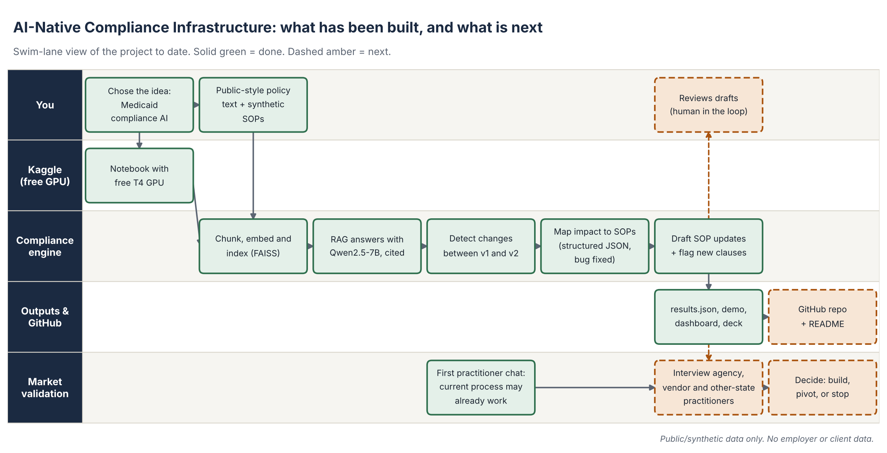

# AI-Native Compliance Infrastructure

> **Disclaimer:** Independent personal project for self-learning. Not affiliated with any employer, state agency or vendor. Uses only public documents and synthetic data. No internal or confidential data and no personal data (no SSNs, member or patient records, PHI/PII). Views are my own. See DISCLAIMER.md.

A RAG prototype that detects Medicaid policy changes between document versions, finds the
internal procedures (SOPs) those changes affect, and drafts updated procedure text with
citations to the source policy.

Built on a free Kaggle GPU using only public CMS-style policy text and synthetic internal
procedures.

## The problem

When a Medicaid policy changes, someone has to read it, work out which internal procedures
are affected, and rewrite them by hand. That is slow and easy to get wrong, and mistakes
show up later as audit findings.

## How it works



Green solid boxes are built and tested. Amber dashed boxes are next steps.

1. **Ingest** - split policy text into chunks and embed them (all-MiniLM-L6-v2, FAISS)
2. **Detect changes** - compare old and new versions of the same policy with an LLM
3. **Map impact** - for each SOP, structured JSON says affected or not, with a reason
4. **Draft** - rewrite only the affected numbers in each affected SOP, with citation
5. **Flag** - any sentence in a draft that does not closely match the original SOP is
   marked for human review

## Results on the sample data

Change tested: prior-authorization threshold raised from 15 to 20 visits.

- 2 of 3 SOPs flagged as affected (PT intake, claims appeals)
- The telehealth SOP was correctly left alone (an earlier string-matching bug flagged it;
  fixed with structured JSON output and a negation-aware fallback parser)
- The model still sometimes adds sentences the policy never asked for. These are caught by
  the new-clause flagger and shown to the reviewer, not silently accepted.

## Honest status

Full design document, phase by phase: [docs/DESIGN_DOCUMENT.md](docs/DESIGN_DOCUMENT.md). A full log of what went wrong and what I changed is in [docs/LESSONS_LEARNED.md](docs/LESSONS_LEARNED.md).

- Evaluated on 9 synthetic cases and 1 real public pair (MITA 2.0 to 3.0). Language-model version, latest repeated run: 6 of 10 passed (recall 1.0, but false alarms and removed requirements kept). New rule-based engine (`eval/engine.py`, no GPU, same answer every run): 10 of 10 development and 8 of 8 blind cases, with honest caveats on how much that proves. Details in eval/README.md.
- Not tested on real versioned CMS or state documents.
- Market need is **unvalidated**: a first practitioner conversation suggested the current
  manual process may already be good enough. Customer interviews come before more building.

## Repo layout

```
compliance_agent/  The agent: rule engine, folder scan, MCP server, CLI
tests/       End-to-end agent tests (scan safety, exact drafts, approval, MCP over stdio)
demo_workspace/  Sample policies and SOPs to try the agent on
eval/        Test harness: 6 synthetic + 1 real (MITA 2.0 to 3.0) old/new policy cases with answer keys, scorer, real-document fetcher
notebooks/   Kaggle notebooks, in run order (starter, phase 3 diff, phase 4 drafting)
patches/     Paste-in cells: structured impact fix, stricter draft prompt + flagger
demo/        compliance_demo.html (redline view), compliance_dashboard.html - open in a browser
data/        compliance_results.json - output of a real run
docs/        DESIGN_DOCUMENT.md (phases 0 to now), LESSONS_LEARNED.md, swim-lane diagram, overview PDF, setup guide
```

## Compliance agent (runs anywhere, no GPU)

`compliance_agent/` scans a folder of policy documents, compares each new version with the one before it, finds which SOPs
are affected, and writes suggested updates as diffs with review flags. It never edits your files unless a named person
approves a change.

```
pip install -r requirements.txt
python3 -m compliance_agent scan demo_workspace/policies demo_workspace/sops --out out
# open out/report.md   (drafts and .patch files are in out/drafts, every action is logged in out/audit.jsonl)
python3 tests/test_agent.py        # end-to-end tests, including the MCP server
```

**Folder convention:** `policies/<policy_family>/<file with a date or v1, v2 in the name>` (txt, md, pdf, docx) and `sops/<one file per SOP>`.
Re-running only compares versions it has not seen, and the report accumulates.

**Optional language-model check:** `--judge hf` (local open model) or `--judge api` (hosted model) adds a yes/no check for requirements the rules cannot connect to an SOP. It only sets flags, never writes text, and every answer is logged in the report and audit log. Tests: `python3 tests/test_judge.py`.

**As an MCP connector** (use it from any MCP-capable assistant or tool):

```json
{"mcpServers": {"compliance-agent": {"command": "python3", "args": ["-m", "compliance_agent.mcp_server"], "cwd": "/path/to/compliance-ai"}}}
```

Tools: `compare_policy_text`, `compare_policy_files`, `list_policy_versions`, `suggest_sop_updates`, `scan_workspace`,
`read_audit_log`, `apply_draft` (needs `approved_by`, keeps a backup, logs the approval).

## Run the original notebooks

1. On Kaggle: Create > New Notebook > File > Import Notebook
2. Settings: Accelerator GPU T4 x2, Internet on (phone verification required)
3. Run the notebooks in order, then the two cells in `patches/`
4. Open `demo/compliance_demo.html` to view the redlines

## Stack

| Part | Choice |
|---|---|
| Generation | Qwen2.5-7B-Instruct, 4-bit |
| Embeddings | sentence-transformers all-MiniLM-L6-v2 |
| Search | FAISS |
| Compute | Kaggle T4 x2 |

## Roadmap

- [x] Ingest, retrieve, change detection, impact mapping, draft generation
- [x] Fix wrong-SOP flagging; add human-review flags for invented clauses
- [x] Test harness built: 6 synthetic cases (certification, MITA-style, policy, control) with answer keys - see `eval/`
- [ ] Run the harness on the real model and publish the numbers
- [ ] Grow to 20+ cases and add real old/new public document pairs
- [ ] Run on real public versioned CMS documents
- [ ] Customer interviews (agency, vendor, other-state practitioners) - decide build, pivot or stop
- [ ] Hosted backend so results persist

---

*Independent personal project. No proprietary, client, employer or agency data, and no personal data of any kind, is used anywhere in this repository. See [DISCLAIMER.md](DISCLAIMER.md).*
