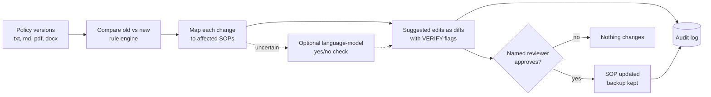

# AI-Native Compliance Infrastructure

> **Disclaimer:** Independent personal project for self-learning. Not affiliated with any employer, state agency or vendor. Uses only public documents and synthetic data. No internal or confidential data and no personal data (no SSNs, member or patient records, PHI/PII). Views are my own. See DISCLAIMER.md.

A compliance agent that compares versions of Medicaid policy documents, finds the internal
procedures (SOPs) each change affects, and suggests updated procedure text as reviewable diffs.
Nothing is changed without a named reviewer's approval, and every action is logged.

It started as a language-model (RAG) pipeline on a free Kaggle GPU. Testing showed the model
was unreliable at exact work, so checkable decisions now come from a rule-based engine, and a
language model is used only for narrow yes/no questions about meaning. Only public CMS
documents and synthetic SOPs are used.

## The problem

When a Medicaid policy changes, someone has to read it, work out which internal procedures
are affected, and rewrite them by hand. That is slow and easy to get wrong, and mistakes
show up later as audit findings.

## How it works



1. **Compare** - align sentences between versions; ignore rewording; catch changed numbers and
   dates, added and removed requirements, and removal notices
2. **Map** - flag an SOP for a changed value only if it states the old value and shares words
   with the changed sentence; for an added or removed requirement, only if it shares a rare word
3. **Draft** - swap the value, cut the dropped clause, or copy the new policy sentence word for
   word. Text is never invented, and every edit carries a VERIFY flag
4. **Check meaning (optional)** - a language model answers narrow yes/no questions the rules
   cannot, such as whether a requirement applies to an SOP that shares none of its words.
   It only sets flags and never writes text
5. **Approve** - a named person approves each change; a backup is kept and the approval logged

## Example output

From `demo_workspace/`: the policy raised the prior-authorization threshold from 15 to 20 visits.

```diff
--- front_desk_visit_check (current)
+++ front_desk_visit_check (suggested)
-Front desk staff verify the visit count against the 15-visit prior authorization threshold before scheduling.
+Front desk staff verify the visit count against the 20-visit prior authorization threshold before scheduling.
 Escalate unclear cases to the billing lead.
```

Flag shown to the reviewer: `VERIFY: value changed ['15'] -> ['20']`

## Results

| Version | Test | Result |
|---|---|---|
| Language model (Qwen2.5-7B) | 10 development cases, 3 repeated runs | 6 of 10: found every change, but false alarms, removed requirements kept, answers varied run to run |
| Rule engine | 10 development cases (9 synthetic, 1 real: MITA 2.0 to 3.0) | 10 of 10, identical every run |
| Rule engine | 8 blind cases, written after the engine | 8 of 8 |
| Rule engine | 4,000 generated cases, four seeds | 97.6% to 98.3% |
| Full agent | 200 generated policy manuals, real folder scan | 96.7% to 98.5% of checks |

Answer keys are written before any run. Details and the full run log: [eval/README.md](eval/README.md).

## Honest status

- **How far to trust the numbers:** the rules were tuned on the development cases, the blind
  set is partly used after one fix, and the generated tests use my own templates. Fresh,
  independent cases are needed for an unbiased number.
- **Known limit:** rules cannot judge meaning. A requirement added in words the SOP never uses
  is missed; that is what the language-model check is for, and its accuracy is not yet measured.
- **Real documents:** one real public pair (MITA 2.0 to 3.0) passes. No second real pair and no
  real SOPs yet.
- **Market need is unvalidated:** a first practitioner conversation suggested the current
  manual process may already be good enough. Customer interviews come before more building.

Design document, phase by phase: [docs/DESIGN_DOCUMENT.md](docs/DESIGN_DOCUMENT.md). What went
wrong and what I changed: [docs/LESSONS_LEARNED.md](docs/LESSONS_LEARNED.md). One-page overview:
[docs/Compliance_AI_Overview.pdf](docs/Compliance_AI_Overview.pdf).

## Repo layout

```
compliance_agent/  The agent: rule engine, folder scan, MCP server, CLI
tests/       End-to-end agent tests (scan safety, exact drafts, approval, MCP over stdio)
demo_workspace/  Sample policies and SOPs to try the agent on
eval/        Test harness: 10 development cases (9 synthetic + 1 real, MITA 2.0 to 3.0) and 8 blind cases with answer keys, scorer, real-document fetcher
notebooks/   Kaggle notebooks, in run order (starter, phase 3 diff, phase 4 drafting)
patches/     Paste-in cells: structured impact fix, stricter draft prompt + flagger
demo/        compliance_demo.html (redline view), compliance_dashboard.html - open in a browser
data/        compliance_results.json - output of a real run
docs/        DESIGN_DOCUMENT.md (phases 0 to now), LESSONS_LEARNED.md, swim-lane diagram, overview PDF, setup guide
```

## Compliance agent (runs anywhere, no GPU)

`compliance_agent/` scans a folder of policy documents, compares each new version with the one before it, finds which SOPs
are affected, and writes suggested updates as diffs with review flags. It never edits your files unless a named person
approves a change.

```
pip install -r requirements.txt
python3 -m compliance_agent scan demo_workspace/policies demo_workspace/sops --out out
# open out/report.md   (drafts and .patch files are in out/drafts, every action is logged in out/audit.jsonl)
python3 tests/test_agent.py        # end-to-end tests, including the MCP server
```

**Folder convention:** `policies/<policy_family>/<file with a date or v1, v2 in the name>` (txt, md, pdf, docx) and `sops/<one file per SOP>`.
Re-running only compares versions it has not seen, and the report accumulates.

**Optional language-model check:** `--judge hf` (local open model) or `--judge api` (hosted model) adds a yes/no check for requirements the rules cannot connect to an SOP. It only sets flags, never writes text, and every answer is logged in the report and audit log. Tests: `python3 tests/test_judge.py`.

**As an MCP connector** (use it from any MCP-capable assistant or tool):

```json
{"mcpServers": {"compliance-agent": {"command": "python3", "args": ["-m", "compliance_agent.mcp_server"], "cwd": "/path/to/compliance-ai"}}}
```

Tools: `compare_policy_text`, `compare_policy_files`, `list_policy_versions`, `suggest_sop_updates`, `scan_workspace`,
`read_audit_log`, `apply_draft` (needs `approved_by`, keeps a backup, logs the approval).

## Run the original notebooks

The original language-model pipeline, kept for the record ([diagram](docs/swimlane.png)).

1. On Kaggle: Create > New Notebook > File > Import Notebook
2. Settings: Accelerator GPU T4 x2, Internet on (phone verification required)
3. Run the notebooks in order, then the two cells in `patches/`
4. Open `demo/compliance_demo.html` to view the redlines

## Stack

| Part | Current agent | Original pipeline |
|---|---|---|
| Change detection, mapping, drafting | Rule-based engine (Python, no GPU) | Qwen2.5-7B-Instruct, 4-bit |
| Meaning check | Optional language model, local (`hf`) or hosted (`api`) | - |
| Retrieval | - | sentence-transformers all-MiniLM-L6-v2, FAISS |
| Interface | Command line and MCP server | Kaggle notebooks |
| Compute | Any machine | Kaggle T4 x2 |

## Roadmap

- [x] Ingest, retrieve, change detection, impact mapping, draft generation
- [x] Fix wrong-SOP flagging; add human-review flags for invented clauses
- [x] Test harness built: 18 cases (9 synthetic, 1 real public pair, 8 blind) with answer keys - see `eval/`
- [x] Run the harness on the real model and publish the numbers (language model 6/10; rule engine 10/10 and 8/8 blind)
- [ ] Grow past 20 cases and add more real old/new public document pairs (1 so far)
- [x] Rule-based engine, compliance agent, approval-gated edits, audit log, MCP server
- [x] Generated scale tests: 4,000 cases and 200 whole manuals
- [x] Optional language-model check (built and safety-tested)
- [ ] Measure the language-model check's accuracy
- [ ] Fresh blind cases; run on more real public versioned CMS documents
- [ ] Customer interviews (agency, vendor, other-state practitioners) - decide build, pivot or stop
- [ ] Hosted backend so results persist

---

*Independent personal project. No proprietary, client, employer or agency data, and no personal data of any kind, is used anywhere in this repository. See [DISCLAIMER.md](DISCLAIMER.md).*
